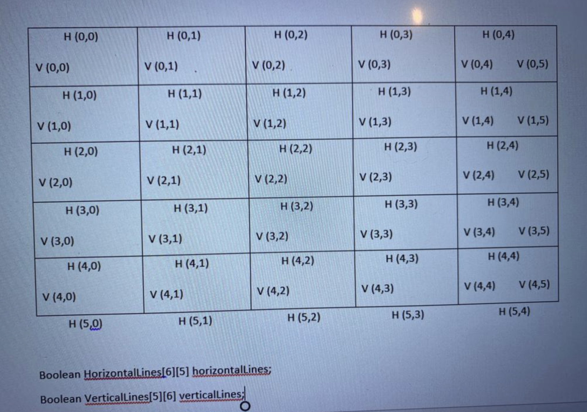

<div align="center">

# Dots & Boxes

A JavaFX implementation of the classic strategy game, featuring local play, computer opponents, and online multiplayer.

[](https://openjdk.org/)
[](https://openjfx.io/)
[](https://maven.apache.org/)
[](https://junit.org/junit5/)

</div>

## About

Dots & Boxes is a desktop version of the classic pencil-and-paper game. Players take turns connecting neighboring dots. Completing the fourth side of a box earns a point and another turn; the player with the most boxes when the board is full wins.

This project supports several offline game modes as well as socket-based multiplayer. It includes a JavaFX interface, a configurable AI player, a multithreaded game server, terminal clients, and generated Javadoc.

## Features

- Local Player vs Player gameplay
- Player vs AI gameplay
- AI vs AI simulation
- Online multiplayer through a socket server
- Human and AI-controlled network clients
- Easy and strategic AI difficulty options
- Automatic score, turn, and completed-box tracking
- Light and dark interface themes
- Game reset and replay flow
- Graphical and terminal-based clients
- Javadoc in the `docs` directory

## How the AI works

The strategic AI chooses moves in three stages:

1. Complete a box immediately when possible.
2. Prefer safe moves that do not leave a three-sided box for the opponent.
3. When only risky moves remain, evaluate the available chains and choose the move expected to concede the fewest points.

Easy mode instead selects randomly from the available moves.

## Tech stack

| Area | Technology |
| --- | --- |
| Language | Java 17 |
| Interface | JavaFX 17 |
| Networking | Java sockets and multithreading |
| Build | Maven Wrapper |
| Testing | JUnit 5 |
| Additional UI libraries | Ikonli and FXGL |

## Getting started

### Prerequisites

- JDK 17
- Git
- An IDE with Maven and JavaFX support, such as IntelliJ IDEA

The Maven wrapper is included, so a separate Maven installation is not required.

### Clone and build

```bash
git clone https://github.com/akdev47/DotsNBoxes.git
cd DotsNBoxes
```

On macOS or Linux:

```bash
./mvnw clean compile
```

On Windows:

```powershell
mvnw.cmd clean compile
```

### Run the graphical game

The most reliable way to launch the current project is through an IDE:

1. Open the repository as a Maven project.
2. Select JDK 17 as the project SDK.
3. Wait for Maven to download the dependencies.
4. Run `BoardDrawingGame.view.DotsAndBoxesGUI`.

> [!NOTE]
> The `javafx-maven-plugin` entry in `pom.xml` still points to an old placeholder main class. To enable `./mvnw javafx:run`, change its `mainClass` value to `src/BoardDrawingGame.view.DotsAndBoxesGUI`.

## Playing locally

Choose one of the game modes on the start screen:

- **Player vs Player** — two people share the same computer.
- **Player vs AI** — play against the computer.
- **AI vs AI** — watch two computer-controlled players complete a full game.

Click one dot and then an adjacent dot to draw a line. If the line completes a box, the current player receives a point and keeps the turn.

## Online multiplayer

### 1. Start the server

Run:

```text
BoardDrawingGame.ServerClient.Server.GameServer
```

Enter an available port number when prompted. The server starts listening on that port and creates a separate connection handler for each client.

### 2. Connect the first client

Run `BoardDrawingGame.view.DotsAndBoxesGUI`, select **Connect To Server**, and follow the prompts to enter:

- The server address, such as `localhost`
- The port selected when starting the server
- A unique username
- A human or AI player

### 3. Connect another client

Start a second instance of the GUI. The repository also contains `GUI2`, which can be used as a second local client during development.

Connect to the same server, choose a different username, and queue both clients. The server matches queued players and synchronizes their moves.

The terminal clients are available at:

- `BoardDrawingGame.ServerClient.Client.PlayerClientTUI`
- `BoardDrawingGame.ServerClient.Client.AIClientTUI`

## Board representation

The game uses a fixed 6 × 6 dot grid, producing 5 × 5 playable boxes. Horizontal edges are stored in a `6 × 5` array and vertical edges in a `5 × 6` array.



## Project structure

```text
.
├── src/main/java
│   ├── BoardDrawingGame
│   │   ├── Entities/       # Board and player models
│   │   ├── logic/          # Rules, scoring, utilities, and AI
│   │   ├── ServerClient/   # Socket protocol, clients, and server
│   │   └── view/           # JavaFX UI components and entry points
│   ├── module-info.java
│   └── BOARDLINES.png
├── src/main/test/          # Existing JUnit test classes
├── docs/                   # Generated Javadoc
├── pom.xml
├── mvnw
└── mvnw.cmd
```

## Tests

The repository contains tests for:

- Marking and validating board lines
- Mapping network move indexes to board edges
- Switching turns
- Completing single and double boxes
- Detecting the end of a full-board game
- Running complete randomized games

The test files currently live in `src/main/test`. Maven's standard test directory is `src/test/java`, so move the files there before running:

```bash
./mvnw test
```

## Documentation

Generated Javadoc is available in [`docs/index.html`](docs/index.html). Open that file in a browser to explore the packages, classes, and public methods.

## Contributors

- [Ali Kaan Uysal](https://github.com/akdev47)
- Bas Van Dijk

## Contributing

Contributions are welcome. If you would like to improve the game:

1. Fork the repository.
2. Create a branch: `git checkout -b feature/your-feature`.
3. Make and test your changes.
4. Commit with a clear message.
5. Open a pull request.

Useful next improvements include correcting the Maven launch configuration, moving the tests to Maven's standard directory, adding gameplay screenshots, and packaging distributable builds.

---

<div align="center">
Made with JavaFX — connect the dots, claim the boxes, and outscore your opponent.
</div>
